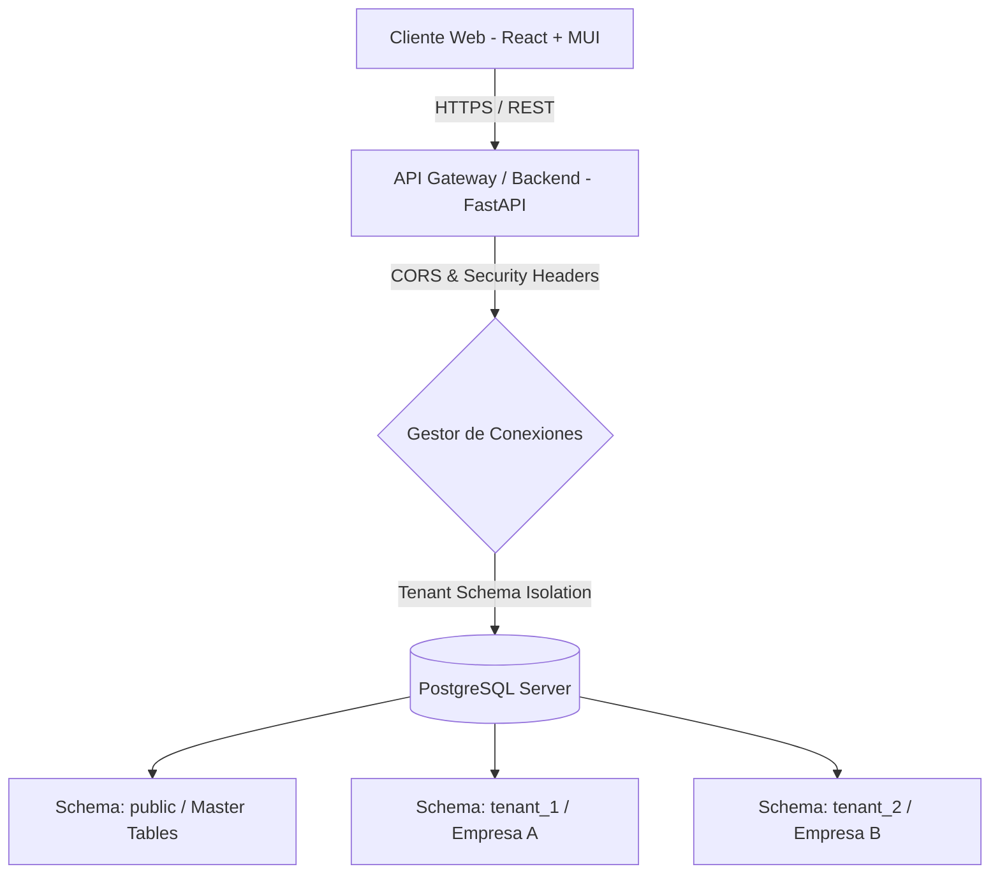

# 🛠️ MANUAL TÉCNICO Y FUNCIONAL — NEXUS ERP VENEZUELA
## SISTEMA DE GESTIÓN EMPRESARIAL MULTI-TENANT DE ALTO RENDIMIENTO

---

## 📌 1. ARQUITECTURA GENERAL DEL SISTEMA

NEXUS ERP es una plataforma multi-inquilino (SaaS Multi-Tenant) diseñada bajo una arquitectura moderna de desacoplamiento total entre el Frontend y el Backend.

### 💻 Frontend (Capa de Presentación)
* **Core:** React 18, TypeScript, Vite.
* **Interfaz de Usuario:** Material-UI (MUI v6) con diseño responsive, temas dinámicos (Claro/Oscuro) y diseño Glassmorphic premium en la pantalla de inicio de sesión.
* **Gestión de Estado:** `zustand` para el estado global de autenticación y parametrización de marca.
* **Consumo de API:** `axios` con interceptores para inyectar automáticamente el token JWT y capturar caídas de sesión.
* **Consultas y Caché:** `@tanstack/react-query` para optimización de peticiones y sincronización de datos en segundo plano.

### ⚙️ Backend (Capa de Negocio)
* **Framework:** FastAPI (Python 3.11+), aprovechando la concurrencia asíncrona mediante `async/await`.
* **ORM:** SQLAlchemy 2.0 (Motor Asíncrono) para el mapeo objeto-relacional y la compilación segura de consultas.
* **Seguridad & Autenticación:** Cifrado de claves mediante `passlib` con algoritmo `bcrypt`. Tokens de acceso de corta duración (JWT) firmados asimétricamente y tokens de actualización (`refresh_tokens`) para sesiones prolongadas de forma segura.

### 🗄️ Base de Datos (Capa de Persistencia)
* **Motor:** PostgreSQL de alto rendimiento.
* **Estrategia Multi-Tenant:** **Single Database, Multiple Schemas** (Una sola base de datos con esquemas aislados por inquilino).
  * **Esquema `public`:** Almacena tablas de control global (inquilinos, suscripciones, usuarios globales).
  * **Esquemas `tenant_{id}`:** Almacena las tablas operacionales (productos, ventas, compras, caja, cuentas por cobrar/pagar, bitácoras) aisladas herméticamente por inquilino.
  * **Conexión Dinámica:** El backend inyecta dinámicamente el `search_path` en la conexión de la base de datos según el inquilino autenticado, garantizando que una sucursal nunca acceda a los datos de otra.

---

## 🔒 2. SEGURIDAD Y PROTECCIÓN DE DATOS (100% SECURE)

NEXUS ERP implementa estrictos protocolos de seguridad corporativa para mitigar vectores de ataque comunes (OWASP Top 10):

### A. Prevención de Inyecciones SQL (SQLi)
* **Cero interpolación de cadenas:** Ninguna consulta SQL se construye uniendo variables de texto.
* **Parámetros Tipados:** El ORM de SQLAlchemy compila automáticamente todas las llamadas en sentencias preparadas y parametrizadas nativas. Cualquier entrada de usuario maliciosa es neutralizada por el controlador PostgreSQL.

### B. Gestión de Sesiones y JWT
* **Algoritmo de firma:** HS256 con claves simétricas de alta entropía.
* **Expiración Corta:** Los tokens de acceso expiran cada 15 minutos. El Frontend solicita automáticamente un nuevo token de acceso en segundo plano mediante el token de actualización (`refresh_token`) si la sesión sigue activa.
* **Cierre Automático por Inactividad:** Monitoreo constante de eventos del mouse y teclado. Si el usuario está inactivo durante el tiempo establecido por la empresa (configurable en configuraciones generales, por ejemplo: 5 minutos), la sesión se destruye en el navegador y el token se revoca.

### C. Mitigación de Vulnerabilidades Web (Cabeceras HTTP)
El backend inyecta automáticamente cabeceras estrictas de seguridad en cada respuesta:
1. `X-Frame-Options: DENY`: Impide que el sistema sea incrustado en `iframes` de otros sitios, anulando ataques de **Clickjacking**.
2. `X-Content-Type-Options: nosniff`: Evita que el navegador adivine el tipo MIME de los archivos, neutralizando la ejecución cruzada de scripts.
3. `Strict-Transport-Security (HSTS)`: Fuerza la conexión mediante HTTPS seguro para evitar ataques de intermediarios (Man-in-the-Middle).
4. `Content-Security-Policy (CSP)`: Delimita los recursos aprobados para carga, protegiendo al cliente contra inyección de scripts externos.

---

## 📦 3. DETALLE FUNCIONAL PASO A PASO POR MÓDULOS

### 🚪 Módulo de Autenticación e Inicio de Sesión
#### Flujo Técnico:
1. El usuario introduce credenciales en la pantalla Glassmorphic.
2. El API recibe las credenciales, busca en el esquema `public` al inquilino correspondiente y verifica el hash de la clave contra el guardado.
3. Si las credenciales son válidas, genera un par de tokens (Access Token y Refresh Token).
4. El Frontend guarda el token en `localStorage` e inicializa el temporizador de inactividad.
5. **Wizard Interactivo de Bienvenida:** Al iniciar sesión por primera vez o si está activo, se monta el modal dialog `SystemWizard` que guía al usuario visualmente por los módulos operacionales primordiales.

---

### 📦 Módulo de Inventario y WMS (Sistemas de Almacén)
#### Flujo Técnico:
* **Catálogo de Productos:** Cada producto se registra con su SKU, descripción, categorías, límites de stock y unidad de medida.
* **Costo Promedio Ponderado (CPP):**
  * El sistema calcula automáticamente el valor monetario real del almacén con la fórmula:
    $$\text{Nuevo Costo Promedio} = \frac{(\text{Stock Actual} \times \text{Costo Actual}) + (\text{Cantidad Comprada} \times \text{Costo de Compra})}{\text{Stock Actual} + \text{Cantidad Comprada}}$$
  * Evita la manipulación manual de costos y garantiza un inventario valorado con precisión legal.
* **Cargos y Descargos Manuales:**
  * **Cargos:** Entradas excepcionales que incrementan existencias sin facturación directa.
  * **Descargos:** Registra la salida física inmediata justificando conceptos como mermas, daños o hurtos. Afecta el inventario y graba la transacción de forma permanente.

---

### 🛒 Módulo de Ventas y Facturación (POS)
#### Flujo Técnico:
1. **Apertura de Caja:** El cajero debe registrar un saldo inicial en caja (Bolívares y Divisas) para habilitar el POS.
2. **Selección de Productos y Precios:** Búsqueda rápida por nombre o código SKU. El sistema recupera el precio base de venta y el impuesto correspondiente de forma automática.
3. **Procesamiento del Pago:**
   * Soporta múltiples métodos de pago combinados en Bolívares y Divisas (Efectivo, Pago Móvil, Punto de Venta, Transferencia).
4. **Finalización:** 
   * Descuenta stock en caliente de la base de datos aplicando exclusión mutua para evitar sobreventas (Double Selling).
   * Genera el registro inmutable del movimiento en el historial y archiva la venta en Tesorería.

---

### 🛒 Compras e Importaciones
#### Flujo Técnico:
1. Registro de facturas de proveedores detallando cantidades compradas y costos reales de adquisición.
2. Al guardar la compra, el backend de forma síncrona:
   * Aumenta el stock disponible del producto.
   * Recalcula el costo promedio ponderado de compra del SKU modificado.
   * Genera una Cuenta por Pagar (CxP) en Tesorería si la compra fue registrada bajo la modalidad de crédito comercial.

---

### 🏦 Tesorería (CxC / CxP)
#### Flujo Técnico:
* **Cuentas por Cobrar (CxC):** Centraliza deudas de clientes generadas por ventas a plazos. Permite realizar abonos controlados y registrar transacciones parciales hasta liquidar la factura original.
* **Cuentas por Pagar (CxP):** Centraliza obligaciones comerciales con proveedores. Permite agendar egresos y controlar abonos para mantener sanas las líneas de crédito comercial.

---

### 📝 Bitácora Universal de Movimientos (`SystemMovement`)
#### Flujo Técnico:
Es el núcleo de auditoría del sistema. Diseñado bajo el principio de **Inmutabilidad Absoluta** (no se permiten modificaciones ni eliminaciones manuales en esta tabla).
* **Campos Registrados:**
  * Fecha y hora exacta (UTC).
  * ID y nombre de usuario responsable del cambio.
  * Módulo operado y tipo de acción realizada.
  * Detalle exacto de cantidades y montos monetarios.
  * Descripción automatizada y detallada estructurada para auditorías oficiales.

---

## 🛠️ 4. VERIFICACIÓN Y MANTENIMIENTO DEL SISTEMA

### Monitoreo del Servidor de Base de Datos
* **Inspección de Pool de Conexiones:** Monitorear que la métrica de conexiones activas no exceda el límite físico de la base de datos (PostgreSQL en Render permite hasta 97 conexiones concurrentes).
* **Consumo de Memoria:** Monitorear que las consultas que cargan grandes volúmenes de datos estén optimizadas mediante paginación (`skip` y `limit` en el API).
