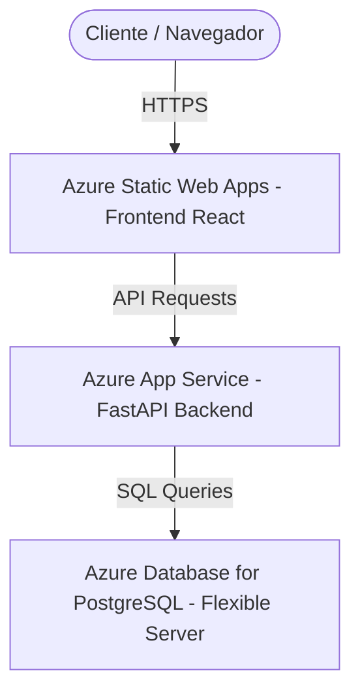

# ☁️ GUÍA PASO A PASO: MIGRACIÓN DE APEX ERP A MICROSOFT AZURE

Esta guía está diseñada especialmente para realizar la migración completa del ecosistema **APEX ERP** a la nube de **Microsoft Azure**, aprovechando la cuenta gratuita de 30 días (que incluye $200 de crédito de prueba) y los niveles de servicio gratuitos de 12 meses.

## 🏛️ Arquitectura Propuesta en Azure
Para mantener costos mínimos, alta velocidad y un despliegue premium, utilizaremos los siguientes tres servicios en la nube de Azure:



1. **Base de Datos:** *Azure Database for PostgreSQL Flexible Server* (Nivel gratuito B1ms - 1 CPU, 2GB RAM, 32GB SSD).
2. **Backend:** *Azure App Service (Web App)* con Linux y runtime Python.
3. **Frontend:** *Azure Static Web Apps* (Servicio especializado 100% gratuito para aplicaciones estáticas de React/Vite con SSL gratis).

---

## 📅 PASO 1: Creación de la Cuenta de Azure de Prueba Gratis
1. Dirígete a: **[https://azure.microsoft.com/es-es/free](https://azure.microsoft.com/es-es/free)**.
2. Haz clic en **"Empezar gratis"**.
3. Inicia sesión con una cuenta de Microsoft (Outlook, Hotmail o Live). Si no tienes una, créala en el momento.
4. **Verificación de Identidad:** Azure te solicitará registrar una tarjeta de crédito. 
   > [!NOTE]
   > Microsoft utiliza la tarjeta únicamente para validar que eres una persona real. **No se te cobrará absolutamente nada** durante los 30 días del periodo de prueba. Una vez finalizados, el servicio se pausará a menos que decidas explícitamente activar la facturación de pago por uso.

---

## 💾 PASO 2: Creación de la Base de Datos PostgreSQL en Azure
1. Entra al **Portal de Azure** en: [https://portal.azure.com](https://portal.azure.com).
2. En la barra de búsqueda superior, escribe: **Azure Database for PostgreSQL flexible servers**.
3. Selecciona la opción y haz clic en **+ Crear** (o **Create**).
4. Configura los siguientes parámetros en la pestaña **Básico (Basics)**:
   - **Suscripción (Subscription):** *Prueba gratuita (Free Trial)*.
   - **Grupo de recursos (Resource group):** Haz clic en *Crear nuevo* y llámalo `apex-erp-rg`.
   - **Nombre del servidor (Server name):** `apex-erp-db-server` (debe ser único).
   - **Región (Region):** Selecciona `East US` o `East US 2`.
   - **Versión de PostgreSQL:** `15` (o `16`).
   - **Tipo de carga de trabajo (Workload type):** Selecciona **Desarrollo (Development)**.
   - **Proceso y almacenamiento (Compute + storage):** Haz clic en *Configurar servidor*. Selecciona **Nivel básico (Burstable)** y elige el tamaño `Standard_B1ms` (1 vCPU, 2 GB RAM). Esto califica para el plan gratuito. Deja el almacenamiento en **32 GB**. Haz clic en *Guardar*.
   - **Método de autenticación:** Selecciona *Autenticación de PostgreSQL únicamente*.
   - **Nombre de usuario del administrador:** `apex_admin`.
   - **Contraseña:** Elige una contraseña segura y guárdala.
5. Pestaña **Redes (Networking)**:
   - **Acceso a la conectividad:** Selecciona *Acceso público (direcciones IP permitidas)*.
   - **Reglas de firewall:** Marca la casilla **"Permitir acceso público desde cualquier servicio de Azure a este servidor"** (esto es crucial para que el Backend en App Service pueda conectarse).
   - Haz clic en **+ Agregar dirección IP actual** para que puedas conectarte desde tu máquina local si necesitas migrar datos.
6. Haz clic en **Revisar y crear** y luego en **Crear**. (La provisión del servidor tarda unos 2-3 minutos).
7. Cuando termine, copia el **Nombre del host** (ej. `apex-erp-db-server.postgres.database.azure.com`).

---

## 🐍 PASO 3: Despliegue del Backend en Azure App Service
1. En el portal de Azure, busca **App Services** y haz clic en **+ Crear -> Aplicación web (Web App)**.
2. Configura los siguientes campos:
   - **Grupo de recursos:** Selecciona `apex-erp-rg`.
   - **Nombre:** `apex-erp-backend` (debe ser único).
   - **Publicar:** Selecciona **Código (Code)**.
   - **Pila de runtime (Runtime stack):** `Python 3.10` o `Python 3.11`.
   - **Sistema operativo:** `Linux`.
   - **Región:** `East US`.
   - **Plan de Linux:** Haz clic en *Crear nuevo* (llámalo `apex-backend-plan`).
   - **Precios (Pricing plan):** Haz clic en *Cambiar tamaño*. Selecciona la pestaña **Desarrollo/Pruebas (Dev/Test)** y elige el nivel **F1 / Free** o **B1** (que se descuenta de tu crédito gratuito de $200).
3. Haz clic en **Revisar y crear** y luego en **Crear**.
4. Una vez creado, ve al recurso y haz clic en la sección **Configuración (Configuration)** en el menú izquierdo:
   - En **Configuración de la aplicación (Application settings)**, haz clic en **+ Nueva configuración** para agregar las siguientes Variables de Entorno del Backend:
     * `DATABASE_URL`: `postgresql+asyncpg://apex_admin:<TU_CONTRASEÑA>@<HOST_DE_AZURE>:5432/postgres?ssl=require`
     * `SECRET_KEY`: Una cadena de texto aleatoria muy larga.
     * `ALLOWED_ORIGINS`: `*` (Luego lo reemplazaremos con la URL exacta del frontend).
   - Haz clic en **Guardar (Save)** en la parte superior.
5. **Vincular con GitHub:**
   - Ve a la pestaña **Centro de implementación (Deployment Center)** en el menú izquierdo.
   - En **Origen (Source)**, selecciona **GitHub**.
   - Autoriza a Azure para conectarse a tu cuenta de GitHub.
   - Selecciona tu Organización, el Repositorio de tu Backend (`SIstema-Nexus-Back`) y la rama `main`.
   - Haz clic en **Guardar**. Azure creará automáticamente un flujo de trabajo de GitHub Actions que compilará y desplegará tu backend cada vez que hagas un push a la rama `main`.

---

## 🎨 PASO 4: Despliegue del Frontend en Azure Static Web Apps
1. En el portal de Azure, busca **Static Web Apps** y haz clic en **+ Crear**.
2. Configura los siguientes campos:
   - **Grupo de recursos:** Selecciona `apex-erp-rg`.
   - **Nombre:** `apex-erp-frontend`.
   - **Plan de hospedaje:** Selecciona **Gratuito (Free)**.
   - **Región:** Selecciona la más cercana (ej. `East US 2`).
3. En la sección **Detalles de la implementación (Deployment details)**:
   - Origen: **GitHub**.
   - Inicia sesión y selecciona tu cuenta, el repositorio del Frontend (`Sistema-Nexus-front`) y la rama `main`.
4. En **Detalles de la compilación (Build Details)**:
   - **Preconfiguraciones de compilación (Build Presets):** Selecciona **Vite** (o Custom).
   - **Ubicación de la aplicación (App location):** `/`
   - **Ubicación de la API (Api location):** Deja vacío.
   - **Ubicación del artefacto de la aplicación (Output location):** `dist`
5. Haz clic en **Revisar y crear** y luego en **Crear**.
6. **Vincular el API del Backend:**
   - Una vez creado, ve al recurso y copia la URL pública que te dio Azure para tu frontend (ej. `https://salmon-sea-03829.azurestaticapps.net`).
   - Ve a la sección **Variables de entorno** de tu Static Web App y agrega:
     * `VITE_API_URL`: Coloca la URL de tu App Service de backend (ej. `https://apex-erp-backend.azurewebsites.net/api/v1`).
   - En el backend (App Service), recuerda ir a *Configuración* y actualizar la variable `ALLOWED_ORIGINS` reemplazando el `*` por la URL de tu frontend de Azure para proteger la seguridad CORS.

---

## 🚀 PASO 5: Ejecución de Migraciones e Inicialización de Tablas
Para inicializar la base de datos de Azure con las tablas del ERP:
1. En tu máquina local, edita temporalmente tu archivo local de entorno `.env` en el backend para apuntar a la base de datos de Azure:
   ```env
   DATABASE_URL=postgresql://apex_admin:<TU_CONTRASEÑA>@<HOST_DE_AZURE>:5432/postgres
   ```
2. Abre la terminal local en la carpeta `Backend` y ejecuta el comando de Alembic para crear la estructura de tablas de forma automática:
   ```bash
   alembic upgrade head
   ```
3. Ejecuta el script de semilla o inicialización para crear el usuario superadministrador inicial:
   ```bash
   python update_db.py
   ```
4. Vuelve a cambiar la variable local de tu `.env` a la base de datos local para no escribir datos de prueba locales en producción.

¡Y listo! Tu sistema **APEX ERP** estará 100% activo en la nube de Microsoft Azure de forma gratuita.
